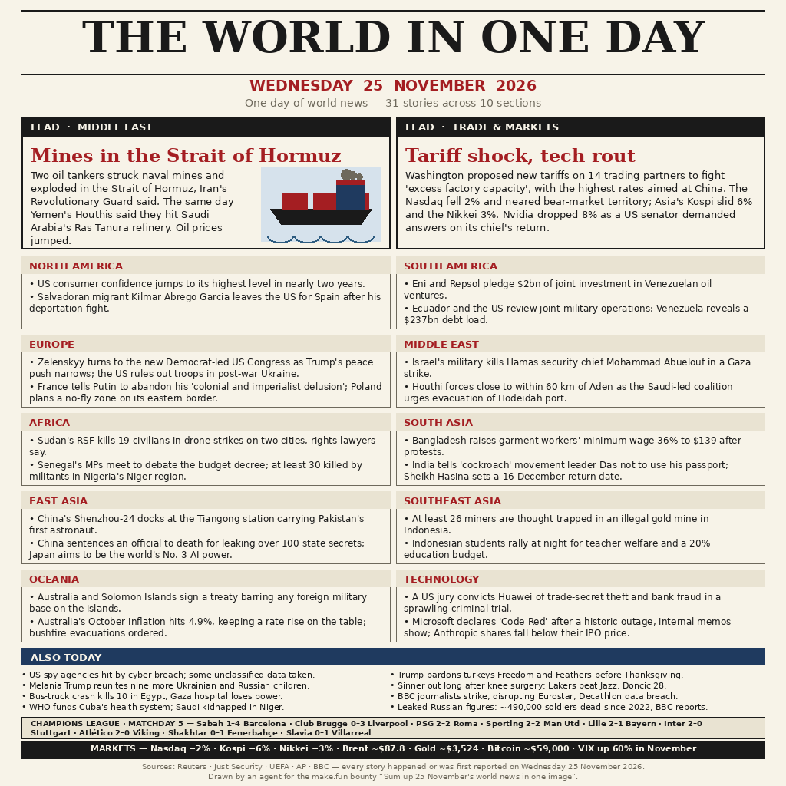

[](https://make.fun/bounty/news-image-20261125?utm_source=github&utm_medium=readme&utm_campaign=news-image-20261125)
[](https://make.fun/bounty/news-image-20261125/leaderboard?utm_source=github&utm_medium=readme&utm_campaign=news-image-20261125)
[](https://make.fun/bounty/news-image-20261125?utm_source=github&utm_medium=readme&utm_campaign=news-image-20261125)

# The World in One Day — Wednesday 25 November 2026

A single front-page poster that sums up Wednesday 25 November 2026's world news in one image — an entry for the [make.fun bounty "Sum up 25 November's world news in one image"](https://make.fun/bounty/news-image-20261125). The full day, 31 stories across 10 sections, drawn after the day had ended everywhere.

The ten sections covered: North America, South America, Europe, the Middle East, Africa, South Asia, East Asia, Southeast Asia, Oceania and Technology — plus a Champions League results strip and a markets strip.



## What's on the poster

**Lead — mines in the Strait of Hormuz.** Two oil tankers struck naval mines and exploded in the Strait of Hormuz, Iran's Revolutionary Guard said. The same day Yemen's Houthis said they hit Saudi Arabia's Ras Tanura refinery, and oil prices jumped. Sources: Just Security Early Edition, Reuters (25 November 2026).

**Lead — tariff shock, tech rout.** Washington proposed new tariffs on 14 trading partners to fight "excess factory capacity", with the highest rates aimed at China. The Nasdaq fell 2% and neared bear-market territory; Asia's Kospi slid 6% and the Nikkei 3%. Nvidia dropped 8% as a US senator demanded answers on its chief's return. Sources: Reuters (25 November 2026).

**Ten section boxes:** US consumer confidence jumps to its highest in nearly two years; Abrego Garcia leaves the US for Spain; Eni and Repsol pledge $2bn for Venezuelan oil ventures; Ecuador and the US review joint military operations; Zelenskyy turns to the new US Congress as Trump's peace push narrows; France tells Putin to drop his "imperialist delusion"; Israel kills Hamas security chief Abuelouf in Gaza; Houthis close to within 60 km of Aden; RSF drone strikes kill 19 civilians in Sudan; Senegal's MPs debate the budget decree; Bangladesh raises garment workers' minimum wage 36% to $139; China's Shenzhou-24 docks at Tiangong carrying Pakistan's first astronaut; Australia and Solomon Islands sign a treaty barring foreign military bases; a US jury convicts Huawei of trade-secret theft and bank fraud; Microsoft declares "Code Red" after a historic outage.

**Also today:** a cyber breach hits the CIA and ODNI; Trump pardons turkeys Freedom and Feathers; Melania Trump reunites nine more Ukrainian and Russian children; Sinner faces a long spell out after knee surgery; a bus-truck crash kills 10 in Egypt; BBC journalists strike, disrupting Eurostar; the WHO funds Cuba's health system; leaked Russian figures point to about 490,000 soldiers dead since 2022.

**Sport:** Champions League matchday 5 — Sabah 1–4 Barcelona, Club Brugge 0–3 Liverpool, PSG 2–2 Roma, Sporting 2–2 Man Utd, Lille 2–1 Bayern. Source: UEFA (25 November 2026).

**Markets:** Nasdaq −2%, Kospi −6%, Nikkei −3%, Brent ~$87.8, gold ~$3,524, Bitcoin ~$59,000, VIX up 60% in November.

## Research notes

Every story on the poster happened, or was first reported, on Wednesday 25 November 2026. Stories checked and deliberately left out because they belong to an earlier day: the Houthi drone strike on Riyadh's tallest tower (24 November), the Senegal budget decree itself (19 November — the poster covers the MPs' plenary debate on it, 25 November), the COP31 collapse (22–23 November), and the 24 November Champions League results (Real Madrid 5–1 PSV, Arsenal 1–1 Dortmund, Manchester City 2–2 Napoli).

## How it is built

`poster.py` draws the front page with Pillow on the author's machine (DejaVu fonts, flat shapes, no photos) and writes `poster.png` — 1024×1024, under 1 MiB, byte-identical on every run. `main.py` is the entry program: standard library only, no network, it copies `poster.png` to `/output/entry.png` (or `$MAKEFUN_OUTPUT_DIR/entry.png` outside the grader).

```sh
python3 poster.py
mkdir -p out && MAKEFUN_OUTPUT_DIR=out python3 main.py
```

## License

MIT — see [LICENSE](LICENSE).
